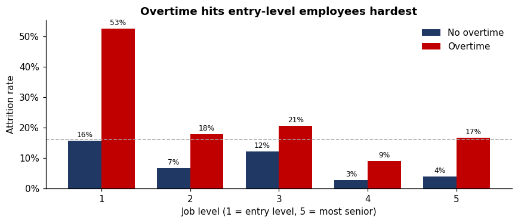
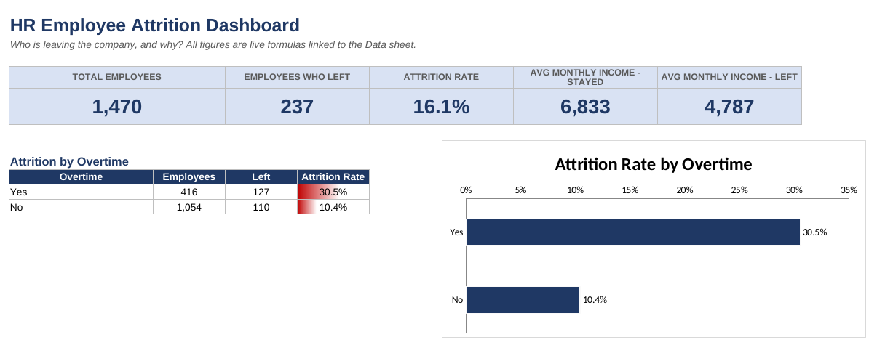
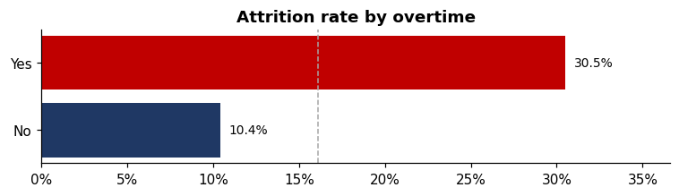
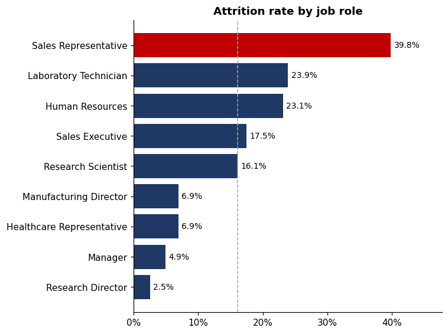
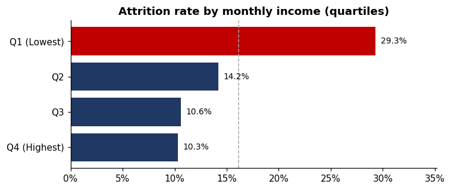
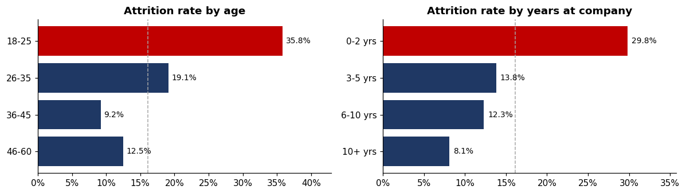
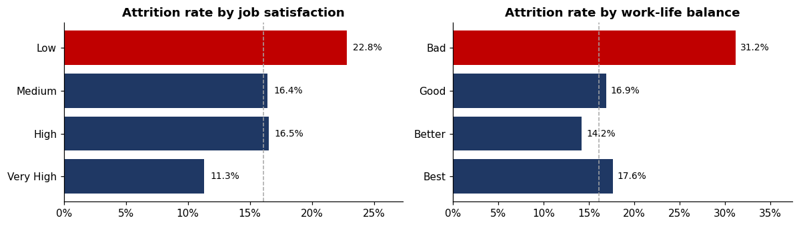

# HR Employee Attrition Analysis

**Who is leaving the company, why, and what can HR do about it?**

An end-to-end data analysis project: **Python** cleans and analyzes 1,470 employee records, finds the main drivers of attrition, and automatically builds an **Excel dashboard** for HR stakeholders.


---

## Business problem

The company loses **16.1% of its employees** (237 of 1,470). Replacing people costs money in hiring, training, and lost productivity. HR wants to know which employees are most likely to leave and what to change first.

## Key findings

| # | Finding | Attrition rate |
|---|---|---|
| 1 | **Entry-level employees working overtime** are the highest-risk group: more than half of them left | **52.6%** (vs 16.1% company average) |
| 2 | **Overtime** workers leave at about 3× the rate of everyone else | 30.5% vs 10.4% |
| 3 | **Sales Representatives** have the highest attrition of any job role | 39.8% |
| 4 | **Young and new employees** leave most: age 18–25 and the first 2 years at the company | 35.8% and 29.8% |
| 5 | The **lowest-paid quarter** of employees leaves at almost 3× the rate of the highest-paid | 29.3% vs 10.3% |
| 6 | Employees reporting **Bad work-life balance** or **Low job satisfaction** leave far more often | 31.2% and 22.8% |

**Business impact:** if overtime workers left at the same rate as other employees, about **84 fewer people would have left**. That's roughly **35% of all attrition**.



## Recommendations

1. **Control overtime**, especially for entry-level staff. Track overtime by team and rebalance workload.
2. **Review Sales Representative pay and targets**, and run exit interviews for this role.
3. **Strengthen the first two years** with structured onboarding, mentors, and check-ins at 3, 6, and 12 months.
4. **Benchmark salaries for the lowest pay band** and show a clear path to promotion.
5. **Use survey scores as an early warning**: follow up quickly with anyone reporting low satisfaction or poor work-life balance.

## Excel dashboard

Python generates `outputs/HR_Attrition_Dashboard.xlsx` automatically. Every number in it is a **live Excel formula** (`COUNTIF`, `COUNTIFS`, `AVERAGEIF`) linked to the data sheet, so the dashboard updates if the data changes.



The workbook has three sheets:
- **Dashboard**: 5 KPI cards and 10 attrition breakdowns (overtime, job role, department, age, tenure, income, job satisfaction, work-life balance, travel, marital status), each with a chart and data bars.
- **Data**: the cleaned table of 1,470 employees, with filters and frozen headers.
- **About**: how each number is calculated, and the data source.

## More charts

| | |
|---|---|
|  |  |
|  |  |



## Approach

1. **Data quality check**: confirmed no missing values or duplicates, and found 3 columns with a single value (removed).
2. **Cleaning and feature engineering**: added a 0/1 attrition flag, replaced survey codes (1–4) with readable labels, and grouped age, tenure, and income into bands.
3. **Analysis**: compared the attrition rate of each group against the company average, then combined the two strongest signals (overtime × job level) to find the highest-risk segment.
4. **Business impact**: a what-if estimate of how many leavers are linked to overtime.
5. **Reporting**: exported the cleaned data and built the Excel dashboard with Python (`openpyxl`).

## Project structure

```
hr-attrition-analysis/
├── data/
│   ├── WA_Fn-UseC_-HR-Employee-Attrition.csv   # raw dataset
│   ├── hr_attrition_clean.csv                  # cleaned data (created by the notebook)
│   └── README.md                               # data source and column notes
├── notebooks/
│   └── hr_attrition_analysis.ipynb             # full analysis, step by step
├── src/
│   ├── prepare_data.py                         # loading and cleaning functions
│   └── build_excel_dashboard.py                # builds the Excel dashboard
├── outputs/
│   └── HR_Attrition_Dashboard.xlsx             # Excel dashboard
├── images/                                     # charts used in this README
├── requirements.txt
└── README.md
```

## How to run

```bash
git clone https://github.com/aneeshh07/hr-attrition-analysis.git
cd hr-attrition-analysis
pip install -r requirements.txt

# Option 1: run the full analysis in Jupyter
jupyter notebook notebooks/hr_attrition_analysis.ipynb

# Option 2: only rebuild the Excel dashboard
python src/build_excel_dashboard.py
```

## Tools and skills

- **Python**: pandas (cleaning, grouping, pivot tables), Matplotlib (charts), openpyxl (Excel automation)
- **Excel**: COUNTIF / COUNTIFS / AVERAGEIF formulas, KPI cards, conditional formatting (data bars), charts, filters
- **Analysis**: data quality checks, feature engineering, segment analysis, what-if impact estimate, business recommendations

## Data and limitations

- **Source:** [IBM HR Analytics Employee Attrition & Performance](https://www.kaggle.com/datasets/pavansubhasht/ibm-hr-analytics-attrition-dataset) on Kaggle.
- It is a **fictional dataset created by IBM data scientists** for learning, so the findings show analysis skills rather than facts about a real company.
- The analysis compares groups. It shows **patterns, not causes**. Some factors overlap; for example, younger employees are also more likely to be single, entry-level, and lower paid.

## Author

**Aneesh Dixit**

- LinkedIn: [linkedin.com/in/aneesh-dixit-b37721354](https://www.linkedin.com/in/aneesh-dixit-b37721354)
- Email: [aneeshdixit07@gmail.com](mailto:aneeshdixit07@gmail.com)
- GitHub: [@aneeshh07](https://github.com/aneeshh07)
